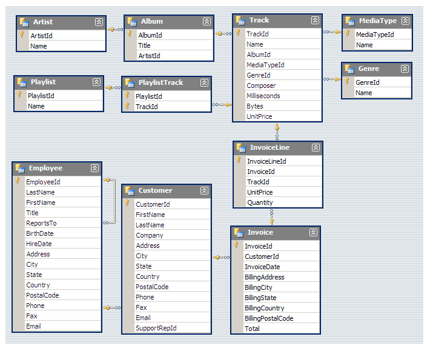

# Music Store Analysis with SQL

SQL analysis of an online music store's relational database (PostgreSQL) to answer **11 business questions** about employees, customers, sales by country and city, genres and artists, from basic aggregation to advanced CTEs and window functions.

**Stack:** PostgreSQL 14 · JOINs · Subqueries · CTEs · `ROW_NUMBER()` window function · Recursive CTE

---

## Data model

The database has 11 related tables, from `artist → album → track` to `invoice_line → invoice → customer`, plus `genre`, `media_type`, `playlist`, `playlist_track` and `employee`.

<p align="center">
  
</p>

## Business questions

**Set 1: Basic**
1. Who is the most senior employee based on job title?
2. Which countries have the most invoices?
3. What are the top 3 invoice totals?
4. Which city has the best customers (highest invoice total), to host a promotional music festival?
5. Who is the best customer (highest total spending)?

**Set 2: Intermediate**

6. Email, first name, last name and genre of all Rock listeners, ordered by email (solved two ways: subquery and JOINs).
7. Top 10 artists who wrote the most Rock tracks.
8. Tracks longer than the average song length, longest first.

**Set 3: Advanced**

9. How much each customer spent on each artist (CTE for the best-selling artist).
10. Most popular genre per country, ties included (solved with a CTE + `ROW_NUMBER() OVER (PARTITION BY country ...)` and with a recursive CTE).
11. Top-spending customer per country, ties included (CTE + window function and recursive CTE).

## Repository structure

```
├── Music_Store_database.sql                 -- PostgreSQL dump (schema + data)
├── Music_Store_Query.sql                    -- solutions to the 11 questions
├── Music Store Analysis-Questions.pdf       -- project brief
├── MusicDatabaseSchema.png
├── music store data.zip                     -- CSV data
└── Raw-Music Store Analysis-SQL Project.zip
```

## Run it yourself

1. Create a database in PostgreSQL and restore `Music_Store_database.sql` (for example with pgAdmin → Restore).
2. Open `Music_Store_Query.sql` and run each query.

---

**Stanly Fernández** · [LinkedIn](https://www.linkedin.com/in/stanly-fernandez/) · [Portfolio](https://stanly06.github.io/) · [GitHub](https://github.com/Stanly06)
